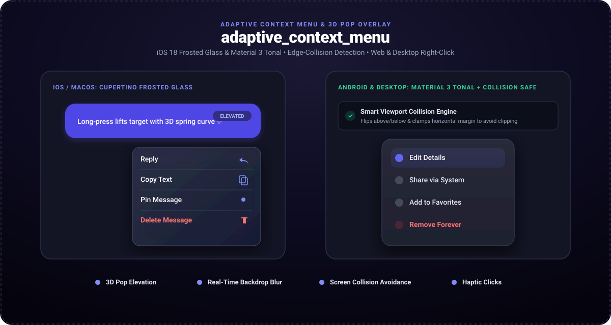

# adaptive_context_menu

<p align="center">
  <a href="https://pub.dev/packages/adaptive_context_menu"></a>
  <a href="https://pub.dev/packages/adaptive_context_menu/score"></a>
  <a href="https://govindtank.github.io/adaptive_context_menu/"></a>
  <a href="https://github.com/govindtank/adaptive_context_menu"></a>
  <a href="https://github.com/govindtank/adaptive_context_menu/blob/main/LICENSE"></a>
  <a href="https://buymeacoffee.com/govindtanko"></a>
  <a href="https://github.com/sponsors/govindtank"></a>
</p>

<p align="center">
  <strong>Adaptive context menu with 3D pop preview and real-time backdrop blur.</strong><br>
  Intelligent screen-edge collision engine, iOS 18 frosted glass and Material 3 surfaces, and native desktop/web right-click support.
</p>

---

<p align="center">
  <a href="https://govindtank.github.io/adaptive_context_menu/">
    
  </a>
</p>

<p align="center">
  🎮 <strong><a href="https://govindtank.github.io/adaptive_context_menu/">Launch Live In-Browser Interactive Demo</a></strong>
</p>

---

## ✨ Features

- **🔍 3D Pop Preview Elevation:** Long-press lifts the target widget smoothly toward the user with spring physics while blurring the background.
- **🛡️ Collision-Safe Positioning Engine:** Automatically measures screen boundaries (`MediaQuery.sizeOf`). If tapped near the screen bottom or edges, the menu flips upward or shifts inward so menu items are never clipped off-screen.
- **🍏 Adaptive Design:** Renders authentic iOS/macOS frosted-glass blur cards on Apple devices and clean Material 3 tonal elevation with ripple feedback on Android and web.
- **🖱️ Web & Desktop First:** Native secondary click (right-click) support on desktop and browser, combined with smooth mobile long-press gestures.
- **📳 Haptic Detents:** Tactile haptic feedback on menu open and option selection.
- **📦 Zero External Dependencies:** Pure Flutter widget layer. Full compatibility across Android, iOS, Web, macOS, Windows, and Linux.

---

## 🚀 Getting Started

Add `adaptive_context_menu` to your `pubspec.yaml`:

```yaml
dependencies:
  adaptive_context_menu: ^1.0.1
```

Import the package:

```dart
import 'package:adaptive_context_menu/adaptive_context_menu.dart';
```

---

## 💡 Usage

Wrap any widget with `AdaptiveContextMenu`:

```dart
AdaptiveContextMenu(
  actions: [
    AdaptiveContextAction(
      title: 'Reply',
      icon: Icons.reply,
      onPressed: () => handleReply(),
    ),
    AdaptiveContextAction(
      title: 'Copy Text',
      icon: Icons.copy,
      onPressed: () => handleCopy(),
    ),
    const AdaptiveContextDivider(),
    AdaptiveContextAction(
      title: 'Delete',
      icon: Icons.delete_outline,
      isDestructive: true,
      onPressed: () => handleDelete(),
    ),
  ],
  child: ChatBubbleWidget(),
)
```

---

## ⚙️ Configuration

| Property | Type | Default | Description |
| :--- | :--- | :--- | :--- |
| `child` | `Widget` | *required* | The widget that triggers the context menu. |
| `actions` | `List<AdaptiveContextMenuEntry>` | *required* | List of `AdaptiveContextAction` and `AdaptiveContextDivider`. |
| `previewBuilder` | `Widget Function(BuildContext, Widget)?` | `null` | Optional custom widget builder for the elevated preview. |
| `popScale` | `double` | `1.05` | Scale multiplier for the preview lift animation. |
| `blurSigma` | `double` | `12.0` | Gaussian backdrop blur intensity. |
| `backdropColor` | `Color` | `Color(0x66000000)` | Overlay tint color behind the popped widget. |
| `menuWidth` | `double` | `250.0` | Width of the contextual actions card. |
| `enableHaptics` | `bool` | `true` | Triggers subtle haptic feedback on open and item taps. |
| `enableLongPress` | `bool` | `true` | Enables mobile long-press trigger. |
| `enableSecondaryClick` | `bool` | `true` | Enables right-click trigger on desktop & web. |

---

## 🔗 Related Packages by Author

* **[android_island_bar](https://pub.dev/packages/android_island_bar)** — Universal cross-platform island overlay with hardware cutout snapping.
* **[flutter_sonner](https://pub.dev/packages/flutter_sonner)** — Opinionated stacked action toast & notification HUD inspired by Sonner.
* **[flutter_smooth_marquee](https://pub.dev/packages/flutter_smooth_marquee)** — Performance-first marquee & auto-scrolling ticker with zero-waste overflow detection.
* **[spatial_card](https://pub.dev/packages/spatial_card)** — 3D tactile interactive cards & multi-plane parallax surfaces.
* **[tactile_fluid_slider](https://pub.dev/packages/tactile_fluid_slider)** — Physics-driven tactile fluid slider with spring morphing.

---

## 💖 Support the Project

If you find this project useful, consider supporting its active maintenance and future development:

<p align="left">
  <a href="https://buymeacoffee.com/govindtanko"></a>
  <a href="https://github.com/sponsors/govindtank"></a>
  <a href="https://www.patreon.com/govindtank"></a>
</p>

---

## 📄 License

This project is licensed under the Apache License 2.0 - see the [LICENSE](LICENSE) file for details.

*Maintained with ❤️ by [Govind Tank](https://github.com/govindtank).*
